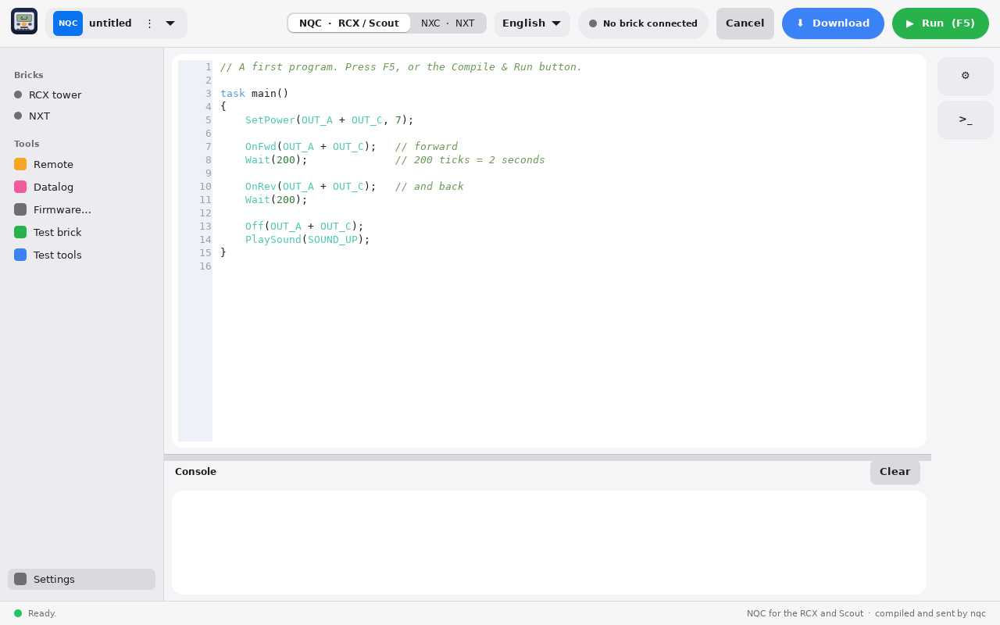
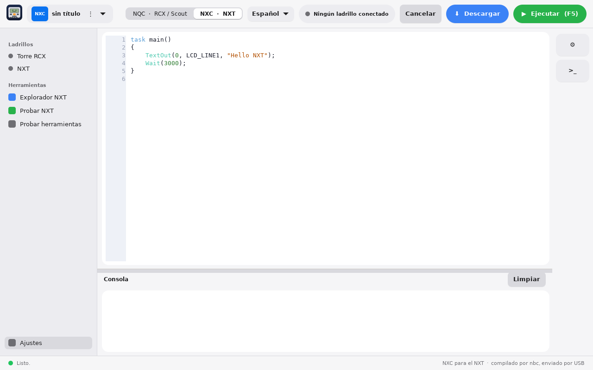

# BrickCode Studio

A native GTK4 + C editor that brings classic robot bricks back to life, in one window:

- **NQC** for the RCX, Scout, CyberMaster and Spybotics (compiled and sent by `nqc`)
- **NXC** for the NXT (compiled by `nbc`; the app uploads and starts the program over USB with libusb)

Write a program, press **F5**, and it compiles, downloads and runs on the brick.
Works on **Linux** (Omarchy theme followed live) and **macOS on Apple Silicon**, with no vendor driver.
The interface is available in **English and Spanish** (selector in the top bar).




## Features

- Syntax highlighting, error line highlighted in the editor
- Compile / Run / Download from the top bar, console below
- Device chip: shows whether an NXT or an RCX tower is connected
- RCX tools: tower port detection, firmware, datalog, IR range, auto-shutoff
- NXT Explorer: files, battery and firmware over USB

## Install

### Linux (Arch / Omarchy)

```
cd nbc-git && makepkg -si                 # NXC compiler + udev rules for the NXT
cd ../brickcode-studio && makepkg -si
```
For NQC also install `nqc` (AUR).

### Linux (Fedora)

Tested first by COPERNICON on Eurobricks (see Thanks below). The app itself only needs GTK4 and libusb:
```
sudo dnf install gcc make pkgconf-pkg-config gtk4-devel libusb1-devel
git clone https://github.com/JimBolanos/brickcode-studio.git
cd brickcode-studio/brickcode-studio
make
sudo make install
```
(`make` needs no sudo, only `make install` does.) To compile programs you also need `nqc` (RCX/Scout) and `nbc` (NXT),
which Fedora does not package. `bash linux/install-fedora.sh` installs all the dependencies, builds nqc, nbc and the app
into `~/.local/brickcode`, and offers the udev rule so the NXT works without root. Unplug and replug the NXT afterwards.

### Linux (other distros)

Install the GTK4 and libusb-1.0 development packages, then `cd brickcode-studio && make && sudo make install`.

### macOS (Apple Silicon)

Needs Homebrew and the Xcode Command Line Tools.
```
bash macos/install-mac.sh
```
It builds nqc, nbc and the app into `~/.local/brickcode` and creates `~/Applications/BrickCode Studio.app`.
The RCX needs its firmware once: gear button → Brick utilities → pick
`~/.local/brickcode/share/firmware/firm0328.lgo` → Send firmware
(keep the RCX 10-20 cm from the tower, about 3-5 minutes).

## Firmware

The RCX needs a firmware once. The files are in the nqc repository, with a short description of each:
https://github.com/jverne/nqc/tree/master/firmware

- `firm0328.lgo` is the RCX 2.0 firmware (target **RCX2**, the default). `firm0332.lgo` is the newest LEGO one and also works.
- `firm0309.lgo` is the original RCX 1.0 firmware (target **RCX**).
- `fast####.lgo` are Dick Swan's firmwares (target **Swan**). Not every one of them works with nqc.

The target menu in BrickCode Studio shows the matching firmware file next to each name. Scout, CyberMaster and Spybotics do not need one.

## Troubleshooting

Open the Brick utilities in the drawer and use **Test tools** (checks that `nqc` and `nbc` are found) and
**Test brick** / **Test NXT** (asks the brick for its version or battery, so you know the USB link works).

On Linux the RCX tower port must be `usb` (not `/dev/usb/legousbtower0`); the **Detect** button sets it for you.
If you get a permission error, add your user to the group that owns the tower (`dialout` or `plugdev`, depending on the distro) and log in again.

## Examples

See the [`examples`](examples) folder: `forward_and_back.nqc` (RCX / Scout), `forward_and_back.nxc` and `touch_sensor_motor.nxc` (NXT).

## Español

BrickCode Studio es un editor nativo para programar ladrillos clásicos: **NQC** (RCX, Scout) y **NXC** (NXT).
Escribe el programa, pulsa **F5** y se compila, se descarga y se ejecuta en el ladrillo.
La interfaz está en inglés y español (selector en la barra superior). La instalación es la misma de arriba.

## About me / Acerca de mí

Hi, I'm **Jim Bolaños**. I build and program LEGO robots as a hobby (RCX, Scout, NXT and Powered Up hubs) and I write about them on my blog.
I made BrickCode Studio so these classic bricks can keep running on modern computers: one editor, no old drivers, on Linux and macOS.
If you find a bug or have an idea, open an issue here or find me at [github.com/JimBolanos](https://github.com/JimBolanos). My builds are on [Rebrickable](https://rebrickable.com/users/jimmy.bolanos/).

Hola, soy **Jim Bolaños**. Programo robots de LEGO como pasatiempo (RCX, Scout, NXT y hubs Powered Up) y escribo sobre ellos en mi blog.
Creé BrickCode Studio para que estos ladrillos clásicos sigan funcionando en computadoras modernas: un solo editor, sin drivers viejos, en Linux y macOS.
Si encuentras un error o tienes una idea, abre un issue aquí o búscame en [github.com/JimBolanos](https://github.com/JimBolanos). Mis creaciones están en [Rebrickable](https://rebrickable.com/users/jimmy.bolanos/).

## Thanks / Agradecimientos

Thanks to **COPERNICON** from the Eurobricks forum for providing feedback and installing BrickCode Studio on Fedora Linux.

Gracias a **COPERNICON** del foro Eurobricks por dar su opinión e instalar BrickCode Studio en Fedora Linux.

## Notes

- nbc is built compile-only; sending the program to the NXT is done by the app itself.
- Settings are stored in `~/.config/brickcode-studio/settings.ini`.

## Legal

BrickCode Studio is an independent project. It is not affiliated with, or endorsed by, the LEGO Group.
LEGO and MINDSTORMS are trademarks of the LEGO Group. nqc (Mozilla Public License) and nbc (GPL) are separate programs by their authors.

MIT License - © 2026 Jim Bolaños · [github.com/JimBolanos](https://github.com/JimBolanos)
