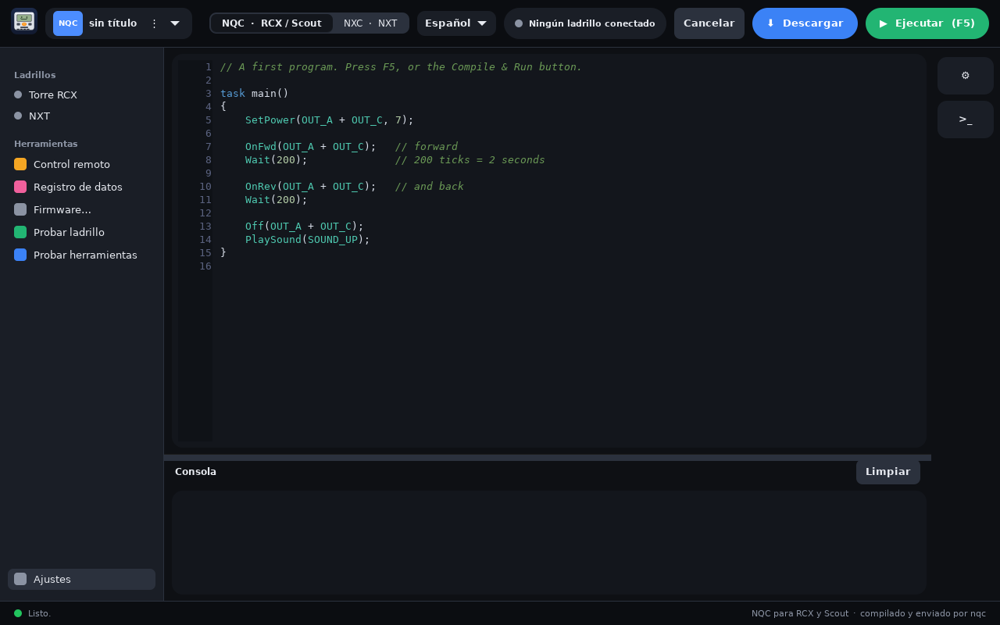

# BrickCode Studio

A native GTK4 + C editor that brings classic robot bricks back to life, in one window:

- **NQC** for the RCX, Scout and Spybotics (compiled and sent by `nqc`)
- **NXC** for the NXT (compiled by `nbc`; the app uploads and starts the program over USB with libusb)

Write a program, press **F5**, and it compiles, downloads and runs on the brick.
Works on **Linux** (Omarchy theme followed live) and **macOS on Apple Silicon**, with no vendor driver.
The interface is available in **English and Spanish** (selector in the top bar).





<p>


</p>

Full guide: [English](docs/USER_GUIDE.en.md) · [Español](docs/USER_GUIDE.es.md)

## What you need to connect

| Brick | How it connects to the computer |
| --- | --- |
| RCX, Scout (and Spybotics) | **LEGO USB Tower** (infrared). The program is sent through the tower, so the brick must be on, close to the tower and pointing at it. |
| NXT | **USB cable** straight to the computer. No tower needed. |

BrickCode Studio uses the **USB tower**. The older **serial tower** has not been tested yet. The tower is not included with this software; you need the original one that came with the RCX / Robotics Invention System 2.0. Details and permissions per system are in the install sections below.

## Features

- macOS-style interface: sidebar with Bricks and Tools, light and dark look, one program at a time
- Syntax highlighting, error line highlighted in the editor
- Compile / Run / Download from the top bar, console below
- Device chip: shows whether an NXT or an RCX tower is connected
- RCX tools: tower port detection, firmware sheet with a real progress bar, datalog, IR range, auto-shutoff
- NXT Explorer: files, battery and firmware over USB
- Remote (RCX): the buttons of the LEGO IR remote (messages, motors A/B/C, programs P1-P5, stop, sound), sent with `nqc`. The motor buttons run the motor while held, like the real remote. The installers patch nqc at build time so it does not wait for a reply the RCX never sends to remote commands (needed for the motor to keep running). Tested on a Mac mini M4 with an RCX 2.0.

## Install

| System | Status |
| --- | --- |
| macOS, Apple Silicon | Confirmed on a Mac mini M4 (RCX and NXT). |
| Linux Mint | Tested by COPERNICON (Eurobricks) with the RCX and the USB tower. NXT not tested yet. |
| Fedora | App built and run by COPERNICON. The tower could not be tested there (USB permissions). |
| Ubuntu / Debian | Should work like Mint (same apt packages). Not tested yet. |
| Arch / Omarchy | Confirmed with RCX and NXT. |

The Spybotics target is in the menu but has not been tested on a real brick yet (the Scout was tested by COPERNICON). Feedback is welcome.

### macOS (Apple Silicon)

Needs Homebrew and the Xcode Command Line Tools. No drivers and no sudo.
```
bash macos/install-mac.sh
```
It builds nqc, nbc and the app into `~/.local/brickcode` and creates `~/Applications/BrickCode Studio.app`.
The RCX needs its firmware once: gear button → Brick utilities → pick
`~/.local/brickcode/share/firmware/firm0328.lgo` (the installer copies it there) → Send firmware
(keep the RCX close to the tower and still, about 3-5 minutes).

### Linux Mint

Steps by COPERNICON (Eurobricks). First plug in the tower and check that the laptop recognises it:
```
sudo dmesg --follow
```
Somewhere in the output you should see "registered new interface driver legousbtower". Then:
```
sudo apt install nqc                      # RCX / Scout compiler
sudo apt install libusb-1.0-0-dev         # libusb
sudo apt install libgtk-4-dev             # GTK4
git clone https://github.com/JimBolanos/brickcode-studio.git
cd brickcode-studio/brickcode-studio
make                                      # no sudo needed
sudo make install
```
In the app, set **Tower port** to `usb` (the **Detect** button does it). A good guide to installing NQC on Linux:
https://brickbot.github.io/nqc/PLATFORM-Linux.html

`nbc`, the compiler for the NXT, is not in the apt repositories. `bash linux/install-debian.sh` builds nqc, nbc and the app into
`~/.local/brickcode` (not tested yet). For the NXT you also need the udev rule `nbc-git/70-nxt.rules`.

### Linux Fedora

First confirmed by COPERNICON (Eurobricks). The app only needs GTK4 and libusb:
```
sudo dnf install gcc make pkgconf-pkg-config gtk4-devel libusb1-devel
git clone https://github.com/JimBolanos/brickcode-studio.git
cd brickcode-studio/brickcode-studio
make
sudo make install
```
`make` needs no sudo, only `make install` does. To compile programs you also need `nqc` (RCX/Scout) and `nbc` (NXT), which Fedora
does not package. `bash linux/install-fedora.sh` installs all the dependencies, builds nqc, nbc and the app into `~/.local/brickcode`,
and offers the udev rule so the NXT works without root. Unplug and replug the NXT afterwards.

For the RCX tower your user needs access to the device (group `dialout` or `plugdev`, depending on the distro); log out and in after adding it.

### Linux Ubuntu / Debian

Same steps as Linux Mint (Mint is based on Ubuntu). Not tested yet; please report what you find.

### Linux Arch / Omarchy

```
cd nbc-git && makepkg -si                 # NXC compiler + udev rules for the NXT
cd ../brickcode-studio && makepkg -si
```
For NQC also install `nqc` (AUR).

### Linux, other distros

Install the GTK4 and libusb-1.0 development packages, then `cd brickcode-studio && make && sudo make install`.

## Firmware

The RCX needs a firmware once. `firm0328.lgo` and `firm0309.lgo` are included in the `firmware/` folder of this repo, and the installers copy them to `~/.local/brickcode/share/firmware/`. Descriptions of all firmware files are in the nqc repository:
https://github.com/jverne/nqc/tree/master/firmware

- `firm0328.lgo` is the RCX 2.0 firmware (target **RCX2**, the default). `firm0332.lgo` is the newest LEGO one and also works.
- `firm0309.lgo` is the original RCX 1.0 firmware (target **RCX**).

The target menu in BrickCode Studio shows the matching firmware file next to each name.

## Troubleshooting

Open the Brick utilities in the drawer and use **Test tools** (checks that `nqc` and `nbc` are found) and
**Test brick** / **Test NXT** (asks the brick for its version or battery, so you know the USB link works).

**Firmware fails with `!!!!` and `firmware transfer failed (-3)`.** The `!` marks are nqc retries and `-3` means the RCX did not answer.
Keep the RCX close to the tower and still, check the batteries, unplug and plug the tower again, and retry.
This failed once on a Mac mini M4 with a freshly reset RCX and worked on a later try, so the cause is not fully known.
If it keeps failing, load the firmware once with another tool or computer; BrickCode Studio works with it afterwards.

On Linux the RCX tower port must be `usb` (not `/dev/usb/legousbtower0`); the **Detect** button sets it for you.
If you get a permission error, add your user to the group that owns the tower (`dialout` or `plugdev`, depending on the distro) and log in again.

## Examples

See the [`examples`](examples) folder: `forward_and_back.nqc`, `counter_to_display.nqc`, `button_to_light.nqc` (RCX) and `scout_button_light.nqc` (Scout); `forward_and_back.nxc` and `touch_sensor_motor.nxc` (NXT). Thanks to Copernicon for the touch-sensor and Scout examples.

## Español

BrickCode Studio es un editor nativo para programar ladrillos clásicos: **NQC** (RCX, Scout) y **NXC** (NXT).
Escribe el programa, pulsa **F5** y se compila, se descarga y se ejecuta en el ladrillo.
La interfaz está en inglés y español (selector en la barra superior). La instalación es la misma de arriba.

**Cómo se conecta cada ladrillo:** el RCX y el Scout se programan con la **torre USB de LEGO** (infrarrojo; el ladrillo debe estar encendido, cerca de la torre y apuntando a ella). La app usa la torre USB; la torre serial aún no se ha probado. El NXT se programa con un **cable USB** directo al computador, sin torre.

## About me / Acerca de mí

Hi, I'm **Jim Bolaños**. I build and program LEGO robots as a hobby (RCX, Scout, NXT and Powered Up hubs) and I write about them on my blog.
I made BrickCode Studio so these classic bricks can keep running on modern computers: one editor, no old drivers, on Linux and macOS.
If you find a bug or have an idea, open an issue here or find me at [github.com/JimBolanos](https://github.com/JimBolanos). My builds are on [Rebrickable](https://rebrickable.com/users/jimmy.bolanos/).

Hola, soy **Jim Bolaños**. Programo robots de LEGO como pasatiempo (RCX, Scout, NXT y hubs Powered Up) y escribo sobre ellos en mi blog.
Creé BrickCode Studio para que estos ladrillos clásicos sigan funcionando en computadoras modernas: un solo editor, sin drivers viejos, en Linux y macOS.
Si encuentras un error o tienes una idea, abre un issue aquí o búscame en [github.com/JimBolanos](https://github.com/JimBolanos). Mis creaciones están en [Rebrickable](https://rebrickable.com/users/jimmy.bolanos/).

## Thanks / Agradecimientos

Thanks to **COPERNICON** from the Eurobricks forum for providing feedback and installing BrickCode Studio on Fedora Linux.

Gracias a **COPERNICON** del foro Eurobricks por dar su opinión e instalar BrickCode Studio en Fedora Linux.

## Notes

- nbc is built compile-only; sending the program to the NXT is done by the app itself.
- Settings are stored in `~/.config/brickcode-studio/settings.ini`.

## Legal

BrickCode Studio is an independent project. It is not affiliated with, or endorsed by, the LEGO Group.
LEGO and MINDSTORMS are trademarks of the LEGO Group. nqc (Mozilla Public License) and nbc (GPL) are separate programs by their authors.

MIT License - © 2026 Jim Bolaños · [github.com/JimBolanos](https://github.com/JimBolanos)
