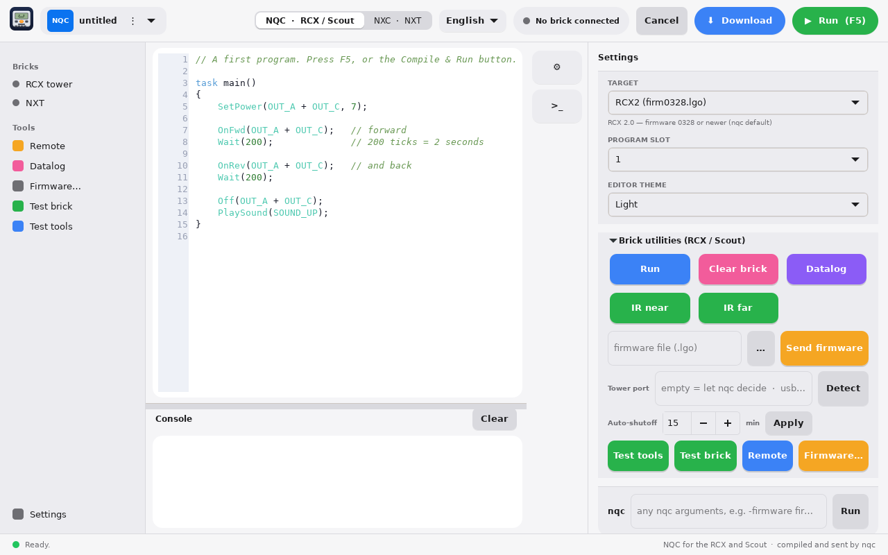
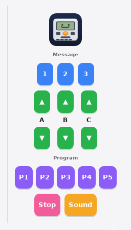
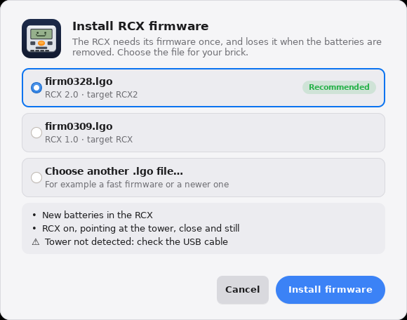
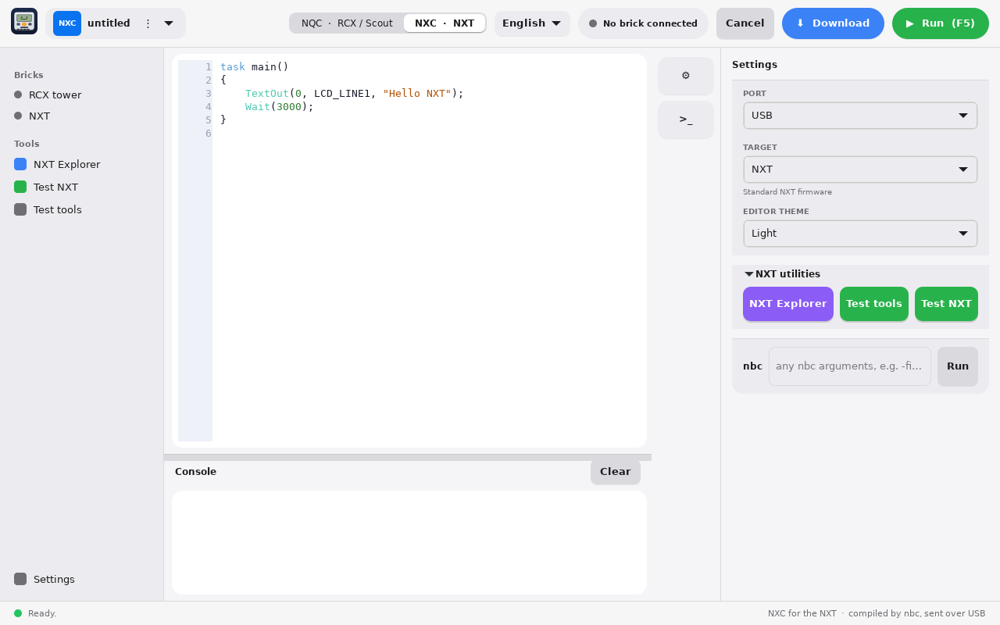
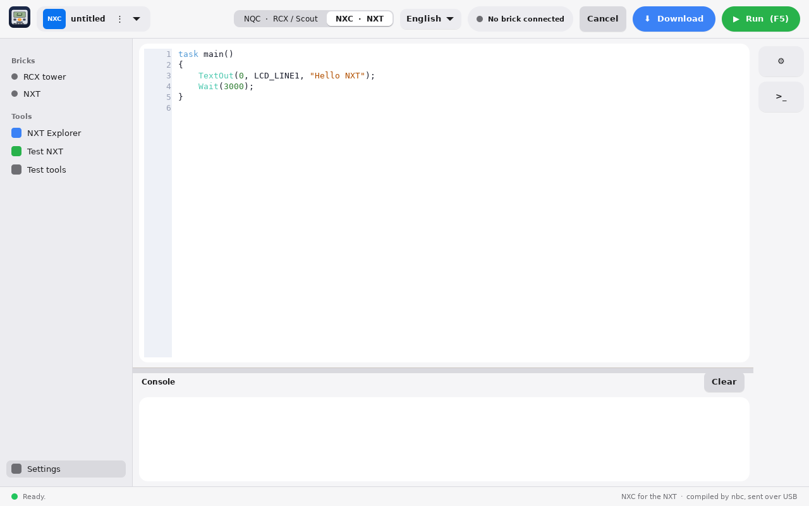

# BrickCode Studio — User guide

[Español](USER_GUIDE.es.md)

## 1. What is BrickCode Studio

BrickCode Studio is a native editor for programming classic LEGO-compatible bricks on Linux and macOS, without old drivers: write the program, press **Run** and the brick runs it.

It supports two languages, switched with the **NQC / NXC** selector in the top bar:

- **NQC** for the RCX and the Scout. `nqc` compiles the program and sends it through the USB tower (infrared).
- **NXC** for the NXT. `nbc` compiles it and the app itself uploads it over USB, with no system driver.

**What you need to connect.** The RCX and the Scout are programmed through the **LEGO USB Tower** (infrared; the serial tower has not been tested yet); the NXT is programmed with a **USB cable** straight to the computer.

The app is only an interface: it uses `nqc` and `nbc` underneath, so both must be installed. It works on Linux (Arch/Omarchy, Fedora, Mint and others) and on macOS with Apple Silicon. The interface is available in English and Spanish.

## 2. Installation

All the code and releases are at [github.com/JimBolanos/brickcode-studio](https://github.com/JimBolanos/brickcode-studio). Run the commands in a terminal from the project folder.

| System | How to install |
| --- | --- |
| Arch / Omarchy | `bash linux/install-arch.sh` builds nqc, nbc and the app in `~/.local/brickcode`. |
| Fedora | `bash linux/install-fedora.sh` installs the dependencies and builds nqc, nbc and the app in `~/.local/brickcode`. |
| Debian / Ubuntu / Mint | `bash linux/install-debian.sh` (same idea as Fedora). |
| Other Linux | Install the GTK4 and libusb-1.0 development packages, then `make && sudo make install`. |
| macOS (Apple Silicon) | With Homebrew and the Xcode Command Line Tools, run `bash macos/install-mac.sh`. It creates `~/Applications/BrickCode Studio.app`. |

The installers also copy the RCX firmware files (`firmware/*.lgo`) and patch `nqc` so the Remote works smoothly.

**USB permissions on Linux.** For the NXT to work without root you need the `70-nxt.rules` udev rule (installed by the `nbc-git` package and the Fedora script); then unplug and replug the NXT. For the RCX tower your user must be in the group that controls it (`dialout` or `plugdev`, depending on the distro); log out and in after adding it.

**macOS needs no drivers and no sudo.** `nqc` talks to the tower by itself and the app uses libusb for the NXT.

## 3. The main window

The window has a sidebar, the editor, the console and, on demand, a settings panel on the right. You work on one program at a time; to work on another, close the window (the app asks to save if there are unsaved changes) and open it again.

| Element | What it does |
| --- | --- |
| Brick icon (top left) | Opens **About**: version, license and author. |
| NQC / NXC tag and file name | Shows the active language and the open program (`untitled` if not saved yet). A dot • after the name means unsaved changes. |
| ⋮ menu | **New**, **Open…**, **Save** and **Save as…**. |
| NQC · RCX / Scout and NXC · NXT selector | Switches the language and the tools shown in the sidebar. |
| Language selector | English or Español, instantly. |
| Brick indicator | A dot and a text: *No brick connected*, *RCX tower connected*, *NXT connected*, *NXT + RCX tower*, or *NXT in firmware mode*. Green when a brick or tower is found. |
| **Cancel** | Stops the running command. Only active while something runs. |
| **Download** | Compiles and sends the program to the brick without running it. |
| **Run (F5)** | Compiles, sends and runs. F5 does the same from the keyboard. |
| ⚙ button (right edge) | Shows or hides the settings panel. |
| >_ button (right edge) | Shows or hides the console. |

The status bar shows the result of the last command (*Ready.*, errors or progress).

### The sidebar

- **Bricks**: a dot for the RCX tower and another for the NXT. It lights up when the device is detected.
- **Tools**: in NQC mode *Remote*, *Datalog*, *Firmware…*, *Test brick* and *Test tools*; in NXC mode *NXT Explorer*, *Test NXT* and *Test tools*.
- **Settings** (bottom): shows or hides the settings panel.

## 4. Files and editor

The editor has line numbers and highlights the syntax of the active language: keywords, brick functions, `#` directives, numbers, strings and comments. The editor theme (dark or light) is chosen in the settings panel.

1. **New** (⋮ menu or + button) replaces the editor content with an example program. It does not ask about unsaved changes, so save first.
2. **Open…** opens `.nqc`, `.nxc`, `.nqh` and `.nxh` files. The app switches to NQC or NXC by the extension.
3. **Save** and **Save as…** save the program. The compiler works on the file, not on the editor text: if you press Run without saving, the app asks for a name and saves first.
4. **Closing the window** with unsaved changes asks: **Save**, **Don't save** or **Cancel**.

In NXC the compiled `.rxe` is left next to the source file, and the name on the NXT is the file name without extension, at most 15 characters, plus `.rxe`.

The `examples/` folder has ready-made programs, for example `forward_and_back.nqc`, `counter_to_display.nqc`, `button_to_light.nqc` (RCX), `scout_button_light.nqc` (Scout), `forward_and_back.nxc` and `touch_sensor_motor.nxc` (NXT).

## 5. NQC mode: RCX and Scout

Open the settings panel (⚙) to see the NQC options.

**Target.** Tells `nqc` which brick you have and which firmware it uses.

| Target | For which brick |
| --- | --- |
| RCX2 (firm0328.lgo) | RCX 2.0 with firmware 0328 or newer. The nqc default. |
| RCX (firm0309.lgo) | RCX 1.0 with the original firmware. |
| Scout | Scout. |
| Spy | Spybotics (not tested). |

**Program slot (1 to 5).** The RCX stores five programs. The chosen slot is where the program is downloaded; **Run** runs the program in the active slot.

**How a program is sent.** **Download** compiles and sends the program to the chosen slot. **Run (F5)** does the same and runs it at once. The brick must be on, close to the tower and pointing at it. Compile errors appear in the console and the app marks the line in the editor.

**Tower port.** Set in *Brick utilities*, **Tower port** field. On Linux and macOS the right value for the USB tower is `usb`. The **Detect** button fills it for you. The serial tower has not been tested yet; if you try it, type its port, for example `/dev/ttyUSB0`, and tell us how it goes. Empty means the `nqc` default.

### Remote

**Remote** (sidebar) opens a window with the keys of the RCX infrared remote control, to move the motors and send messages without writing a program.

| Button | What it does |
| --- | --- |
| Message 1, 2, 3 | Sends message key 1, 2 or 3. An NQC program can read it. |
| ▲ / ▼ of A, B, C | While held, the motor runs forward (▲) or backward (▼). It stops when released. |
| P1 to P5 | Selects program 1 to 5 on the RCX. |
| Stop | Stops the motors. |
| Sound | Sends the remote sound key. |

The RCX needs its firmware, must be on and pointing at the tower, and **Target** and **Tower port** must be right (use **Test brick** to check). The console shows every command sent, prefixed `$ nqc -raw1`.

### Firmware

The RCX needs its firmware once, and loses it when the batteries are removed for a while. **Firmware…** opens a sheet to install it.

1. Choose `firm0328.lgo` (RCX 2.0, recommended), `firm0309.lgo` (RCX 1.0), or **Choose another .lgo file…**. The installers copy the two standard files, so they appear ready to use.
2. Put new batteries in the RCX, turn it on, point it at the tower, close and still.
3. Press **Install firmware**. A progress bar shows the percentage and the block, for example *block 40 of 125*, with the time left. It takes about 3 to 5 minutes. Do not move the RCX until the window says it is done.
4. **Cancel** stops the transfer; the RCX may stay without firmware, so install it again before using the brick. If the RCX does not answer, the sheet says so and offers **Try again**.

## 6. NXC mode: NXT

When you switch to **NXC · NXT**, the settings panel shows the connection port and the fixed target of the NXT (standard firmware).

**Port.** **USB** is the normal choice: the app talks to the NXT directly through libusb. With **Bluetooth** a device field appears, `/dev/rfcomm0` by default, and the download is then done by `nbc`. Bluetooth is only meant for Linux.

**How a program is sent over USB.**

1. `nbc` compiles the `.nxc` into a `.rxe`.
2. If a program is running on the NXT, the app stops it (an NXT does not accept a new file while running another).
3. It deletes the previous version of the file, writes the new one in blocks and closes it. If the NXT says it is busy, it retries up to four times.
4. **Run (F5)** starts the program; **Download** only leaves it saved on the brick.

**NXT Explorer** (sidebar) manages the files on the brick:

- **Connect** connects to the NXT and shows its battery (in mV) and firmware version.
- **Refresh** updates the file list, with each size in bytes.
- **Delete selected** deletes the chosen file. It does not ask for confirmation.

If the NXT is in firmware mode (SAMBA), the top bar says so, but the app does not upload programs in that state.

## 7. Tools, one by one

### NQC mode (RCX and Scout)

| Button | What it does | nqc command |
| --- | --- | --- |
| Run (Brick utilities) | Runs the program already on the brick, sending nothing. | `-run` |
| Clear brick | Deletes all programs and the datalog from the brick. | `-clear` |
| Datalog | Downloads the data log your program recorded and shows it in the console. | `-datalog` |
| IR near | Sets the tower to short range. | `-near` |
| IR far | Sets the tower to long range. | `-far` |
| Send firmware | Sends the chosen `.lgo` file to the RCX. The **…** button opens the file picker. | `-firmware` |
| Tower port + Detect | Sets the tower port. **Detect** finds the right value and writes it. | `RCX_PORT` |
| Auto-shutoff + Apply | Minutes of inactivity before the brick turns itself off. **0** disables it. Stored by the RCX or Scout itself. | `-sleep` |
| Test tools | Checks that `nqc` and `nbc` are in the PATH and shows their path and first help line. | — |
| Test brick | Asks the brick for its version. If it answers, tower, port and brick work. | `-getversion` |

### NXC mode (NXT)

| Button | What it does |
| --- | --- |
| NXT Explorer | Window to see and delete the files on the NXT (section 6). |
| Test tools | Same as in NQC: checks `nqc` and `nbc`. |
| Test NXT | Opens the NXT over USB and asks for battery and firmware version. If it answers, the cable and permissions are fine. |

### Common settings

Besides the target, port and slot, the panel has **Editor theme** (dark or light). Settings are saved when the window closes.

## 8. Console and command line

**Console.** Shown under the editor (**>_** hides it). Every command appears prefixed with `$` and its output in colors: cyan for the command, green for success, red for errors, yellow for warnings and gray for details. **Clear** empties it. When `nqc` or `nbc` report an error with a line number, the app jumps to that line and highlights it.

**Command line.** The bottom row of the settings panel. Its prefix (`nqc` or `nbc`, depending on the mode) is already written; you add the arguments and press **Run**. Use it for any option the interface has no button for, for example `-firmware fast.lgo`, `-sleep 5` or `-pgm 3 -run`. The ↑ and ↓ keys walk through previous commands.

**Time limits.** Every command has a 90-second limit; the firmware transfer, 7 minutes. If time runs out, the app stops the command and says so. **Cancel** stops it earlier.

**Changing mode.** When you switch between NQC and NXC, if the editor still has the untouched starter program, the app puts the starter program of the other language. Your own code is never replaced.

## 9. Troubleshooting

Always start with **Test tools** and **Test brick** (section 7): they separate installation failures from connection failures.

| Symptom | Probable cause | What to do |
| --- | --- | --- |
| *'nqc' was not found* (or nbc) | The tool is not installed or not in the PATH. | Install nqc/nbc (section 2). The app already looks in `~/.local/brickcode/bin`, `~/.local/bin`, `/usr/local/bin` and `/opt/homebrew/bin`. |
| nqc cannot open the tower on Linux | The port has a path like `/dev/usb/legousbtower0`: nqc takes it for a serial port. | Put `usb` in **Tower port** (use **Detect**). |
| Permission denied with the tower or the NXT | Missing udev rule or user group. | Install `70-nxt.rules` for the NXT; add your user to `dialout` or `plugdev` for the tower; log out and reconnect the device. |
| Test brick gets no reply (RCX) | No firmware, low batteries, the RCX is not facing the tower, or the target does not match. | Check the batteries, move it close to the tower, choose the right target and install the firmware if needed. |
| Firmware shows `!!!!` or *failed (-3)* | The RCX did not answer during the transfer. | New batteries, RCX close and still, unplug and replug the tower, try again. |
| *NXT not found* | Cable, brick off, or permissions. | Check the cable, turn the NXT on, install the udev rule and reconnect. **Test NXT** checks it. |
| The NXT says the file exists or is busy | A previous program was still running. | The app stops it and retries. If it persists, stop the program on the NXT with the gray button and try again. |
| The console says *No answer in time* | The command took longer than the limit. | Bring the brick close to the tower and repeat. For firmware, do not move the RCX during the transfer. |
| Run asks to save | The compiler works on a file. | Save the program with a name and press Run again. |

If none of this solves it, open an issue on the GitHub repository or write in the Eurobricks thread, and include what the console shows.

## 10. Language, settings and links

**Language.** The selector in the top bar switches the whole interface between English and Español instantly. The first time, the app picks the system language and remembers your choice.

**Saved settings.** When the window closes, the language, target, slot, port, editor theme and other options are saved in `~/.config/brickcode-studio/settings.ini`. If something behaves oddly, deleting that file restores the defaults.

**Omarchy theme.** On Omarchy the app follows the system theme colors live.

**About.** The brick icon opens a window with the version, the license (MIT) and the author, Jim Bolaños.

**Links.**

- Code and downloads: [github.com/JimBolanos/brickcode-studio](https://github.com/JimBolanos/brickcode-studio)
- Rebrickable profile: [rebrickable.com/users/jimmy.bolanos](https://rebrickable.com/users/jimmy.bolanos/)
- RCX firmware files: [nqc firmware folder](https://github.com/jverne/nqc/tree/master/firmware)

BrickCode Studio is not affiliated with LEGO. LEGO, Mindstorms, RCX, Scout and NXT are trademarks of their respective owners.
