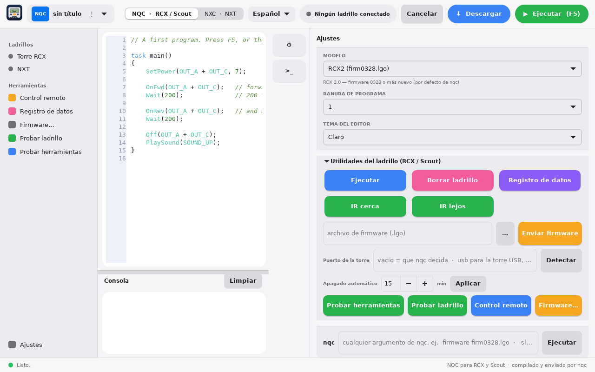
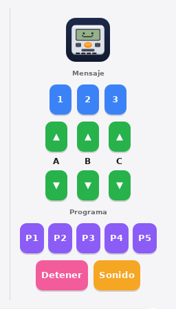
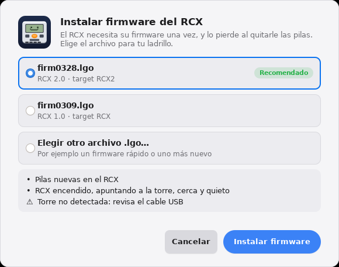
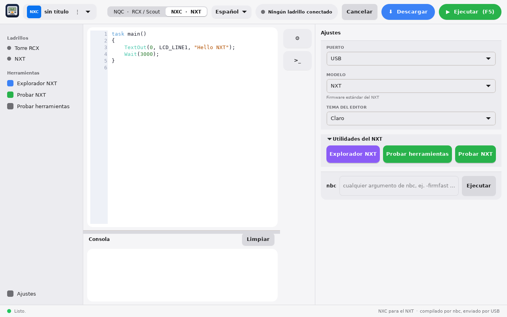

# BrickCode Studio — Guía de usuario

[English](USER_GUIDE.en.md)

## 1. Qué es BrickCode Studio

BrickCode Studio es un editor nativo para programar ladrillos clásicos compatibles con LEGO desde Linux y macOS, sin drivers viejos: escribes el programa, pulsas **Ejecutar** y el ladrillo lo corre.

Soporta dos lenguajes, y la app cambia de uno a otro con el selector **NQC / NXC** de la barra superior:

- **NQC** para el RCX y el Scout. `nqc` compila el programa y lo envía por la torre USB (infrarrojo).
- **NXC** para el NXT. `nbc` lo compila y la propia app lo sube por USB, sin driver del sistema.

**Qué necesitas para conectar.** El RCX y el Scout se programan con la **torre USB de LEGO** (infrarrojo; la torre serial aún no se ha probado); el NXT se programa con un **cable USB** directo al computador.

La app es solo una interfaz: usa `nqc` y `nbc` por debajo, así que ambos deben estar instalados. Funciona en Linux (Arch/Omarchy, Fedora, Mint y otras) y en macOS con Apple Silicon. Está disponible en inglés y español.

## 2. Instalación

Todo el código y las versiones están en [github.com/JimBolanos/brickcode-studio](https://github.com/JimBolanos/brickcode-studio). Los comandos se ejecutan en una terminal desde la carpeta del proyecto.

| Sistema | Cómo instalar |
| --- | --- |
| Arch / Omarchy | `bash linux/install-arch.sh` compila nqc, nbc y la app en `~/.local/brickcode`. |
| Fedora | `bash linux/install-fedora.sh` instala dependencias y compila nqc, nbc y la app en `~/.local/brickcode`. |
| Debian / Ubuntu / Mint | `bash linux/install-debian.sh` (igual que Fedora). |
| Otras distros Linux | Instala los paquetes de desarrollo de GTK4 y libusb-1.0, y ejecuta `make && sudo make install`. |
| macOS (Apple Silicon) | Con Homebrew y las Xcode Command Line Tools, ejecuta `bash macos/install-mac.sh`. Crea `~/Applications/BrickCode Studio.app`. |

Los instaladores también copian los firmware del RCX (`firmware/*.lgo`) y parchean `nqc` para que el control remoto funcione bien.

**Permisos USB en Linux.** Para que el NXT funcione sin ser root hace falta la regla udev `70-nxt.rules` (la instalan el paquete `nbc-git` y el script de Fedora); luego desconecta y vuelve a conectar el NXT. Para la torre del RCX, tu usuario debe pertenecer al grupo que la controla (`dialout` o `plugdev`, según la distro); cierra sesión y vuelve a entrar tras añadirlo.

**macOS no necesita drivers ni sudo.** `nqc` habla con la torre por su cuenta y la app usa libusb para el NXT.

## 3. La ventana principal

La ventana tiene una barra lateral, el editor, la consola y, cuando la pides, un panel de ajustes a la derecha. Se trabaja con un programa a la vez; para trabajar en otro, cierra la ventana (la app pregunta si hay cambios sin guardar) y ábrela de nuevo.

| Elemento | Qué hace |
| --- | --- |
| Icono del ladrillo (arriba a la izquierda) | Abre **Acerca de**: versión, licencia y autor. |
| Etiqueta NQC / NXC y nombre del archivo | Muestra el lenguaje activo y el programa abierto (`sin título` si aún no lo guardas). Un punto • tras el nombre indica cambios sin guardar. |
| Menú ⋮ | **Nuevo**, **Abrir…**, **Guardar** y **Guardar como…**. |
| Selector NQC · RCX / Scout y NXC · NXT | Cambia el lenguaje y las herramientas de la barra lateral. |
| Selector de idioma | English o Español, al instante. |
| Indicador de ladrillo | Un punto y un texto: *Ningún ladrillo conectado*, *Torre RCX conectada*, *NXT conectado*, *NXT + torre RCX* o *NXT en modo firmware*. Verde cuando hay un ladrillo o una torre. |
| **Cancelar** | Detiene el comando en curso. Solo está activo mientras algo se ejecuta. |
| **Descargar** | Compila y envía el programa al ladrillo sin ejecutarlo. |
| **Ejecutar (F5)** | Compila, envía y ejecuta. F5 hace lo mismo desde el teclado. |
| Botón ⚙ (borde derecho) | Muestra u oculta el panel de ajustes. |
| Botón >_ (borde derecho) | Muestra u oculta la consola. |

La franja de estado muestra el resultado del último comando (*Listo.*, errores o el progreso).

### La barra lateral

- **Ladrillos**: un punto para la torre RCX y otro para el NXT. Se enciende cuando el dispositivo se detecta.
- **Herramientas**: en modo NQC *Control remoto*, *Registro de datos*, *Firmware…*, *Probar ladrillo* y *Probar herramientas*; en modo NXC *Explorador NXT*, *Probar NXT* y *Probar herramientas*.
- **Ajustes** (abajo): muestra u oculta el panel de ajustes.

## 4. Archivos y editor

El editor tiene números de línea y resalta la sintaxis del lenguaje activo: palabras clave, funciones del ladrillo, directivas `#`, números, cadenas y comentarios. El tema del editor, oscuro o claro, se elige en el panel de ajustes.

1. **Nuevo** (menú ⋮ o botón +) reemplaza el contenido del editor por un programa de ejemplo. No pregunta si hay cambios sin guardar, así que guarda antes.
2. **Abrir…** abre archivos `.nqc`, `.nxc`, `.nqh` y `.nxh`. La app cambia sola a NQC o NXC según la extensión.
3. **Guardar** y **Guardar como…** guardan el programa. El compilador trabaja sobre el archivo, no sobre el texto del editor: si pulsas Ejecutar sin haber guardado, la app te pide un nombre y guarda primero.
4. **Cerrar la ventana** con cambios sin guardar pregunta: **Guardar**, **No guardar** o **Cancelar**.

En NXC, el compilado `.rxe` queda junto al archivo fuente, y el nombre en el NXT es el del archivo, sin extensión y con un máximo de 15 caracteres, más `.rxe`.

La carpeta `examples/` incluye programas listos, por ejemplo `forward_and_back.nqc`, `counter_to_display.nqc`, `button_to_light.nqc` (RCX), `scout_button_light.nqc` (Scout), `forward_and_back.nxc` y `touch_sensor_motor.nxc` (NXT).

## 5. Modo NQC: RCX y Scout

Abre el panel de ajustes (⚙) para ver las opciones de NQC.

**Modelo (target).** Le dice a `nqc` qué ladrillo tienes y qué firmware usa.

| Target | Para qué ladrillo |
| --- | --- |
| RCX2 (firm0328.lgo) | RCX 2.0 con firmware 0328 o más nuevo. Es el valor por defecto de nqc. |
| RCX (firm0309.lgo) | RCX 1.0 con el firmware original. |
| Scout | Scout. |
| Spy | Spybotics (sin probar). |

**Ranura de programa (1 a 5).** El RCX guarda cinco programas. La ranura elegida es donde se descarga el programa; **Ejecutar** corre el programa de la ranura activa.

**Cómo se manda un programa.** Con **Descargar** la app compila y envía el programa a la ranura elegida. Con **Ejecutar (F5)** hace lo mismo y lo ejecuta de inmediato. El ladrillo debe estar encendido, cerca de la torre y apuntando hacia ella. Si hay errores de compilación, aparecen en la consola y la app marca la línea en el editor.

**Puerto de la torre.** Se configura en *Utilidades del ladrillo*, campo **Puerto de la torre**. En Linux y macOS el valor correcto para la torre USB es `usb`. El botón **Detectar** lo rellena por ti. La torre serial aún no se ha probado; si la usas, escribe su puerto, por ejemplo `/dev/ttyUSB0`, y cuéntanos cómo te va. Si lo dejas vacío, `nqc` usa su valor por defecto.

### Control remoto

**Control remoto** (barra lateral) abre una ventana con las teclas del control remoto infrarrojo del RCX, para mover los motores y mandar mensajes sin escribir un programa.

| Botón | Qué hace |
| --- | --- |
| Mensaje 1, 2, 3 | Envía la tecla de mensaje 1, 2 o 3. Un programa NQC puede leerla. |
| ▲ / ▼ de A, B, C | Mientras mantienes el botón pulsado, el motor gira hacia adelante (▲) o hacia atrás (▼). Al soltarlo, se detiene. |
| P1 a P5 | Elige el programa 1 a 5 del RCX. |
| Detener | Detiene los motores. |
| Sonido | Envía la tecla de sonido del control remoto. |

El RCX necesita su firmware, debe estar encendido y apuntando a la torre, y el **Modelo** y el **Puerto de la torre** deben ser los correctos (usa **Probar ladrillo** para comprobarlo). En la consola aparece cada comando enviado, con el prefijo `$ nqc -raw1`.

### VLL (Micro Scout)

**VLL** (barra lateral, modo NQC) abre una ventana para controlar un Micro Scout desde un ladrillo **Scout**. La app le pide al Scout (por la torre USB) que envíe un código VLL con su luz, así que no hace falta ningún programa.

| Botón | Qué hace |
| --- | --- |
| ▲ / ▼ | Motor hacia adelante / hacia atrás (comandos directos VLL 0 y 1). |
| Pitido 1 a 5 | Reproduce el pitido 1 a 5 (códigos VLL 4 a 8). |

Apunta la luz del Scout hacia el Micro Scout. El Scout debe estar encendido, al alcance de la torre y con su firmware. Siempre usa el modelo Scout, sin importar lo que diga **Modelo**. La consola muestra cada comando, con el prefijo `$ nqc -TScout -raw1`. Aún no se ha probado con hardware real.

### Firmware

El RCX necesita su firmware una sola vez, y lo pierde si se le quitan las pilas un rato. **Firmware…** abre una hoja para instalarlo.

1. Elige `firm0328.lgo` (RCX 2.0, recomendado), `firm0309.lgo` (RCX 1.0) o **Elegir otro archivo .lgo…**. Los instaladores copian los dos archivos estándar, así que aparecen listos para usar.
2. Pon pilas nuevas en el RCX, enciéndelo, apúntalo a la torre, cerca y quieto.
3. Pulsa **Instalar firmware**. Una barra muestra el porcentaje y el bloque, por ejemplo *bloque 40 de 125*, con el tiempo restante. Tarda unos 3 a 5 minutos. No muevas el RCX hasta que la ventana diga que terminó.
4. **Cancelar** detiene la transferencia; el RCX puede quedarse sin firmware, así que instálalo de nuevo antes de usarlo. Si el RCX no responde, la hoja lo avisa y ofrece **Intentar de nuevo**.

## 6. Modo NXC: NXT

Al cambiar a **NXC · NXT**, el panel de ajustes muestra el puerto de conexión y el target fijo del NXT (firmware estándar).

**Puerto.** **USB** es la opción normal: la app habla con el NXT directamente por libusb. Con **Bluetooth** aparece un campo para el dispositivo, por defecto `/dev/rfcomm0`, y en ese caso la descarga la hace `nbc`. Bluetooth solo se ha previsto en Linux.

**Cómo se manda un programa por USB.**

1. `nbc` compila el `.nxc` a un `.rxe`.
2. Si hay un programa corriendo en el NXT, la app lo detiene (un NXT no acepta un archivo nuevo mientras ejecuta otro).
3. Borra la versión anterior del archivo, escribe la nueva en bloques y la cierra. Si el NXT responde que está ocupado, reintenta hasta cuatro veces.
4. Con **Ejecutar (F5)** arranca el programa; con **Descargar** solo lo deja guardado en el ladrillo.

**Explorador NXT** (barra lateral) gestiona los archivos del ladrillo:

- **Conectar** conecta con el NXT y muestra su batería (en mV) y su versión de firmware.
- **Actualizar** refresca la lista de archivos, con el tamaño de cada uno en bytes.
- **Eliminar selección** borra el archivo elegido. No pide confirmación.

Si el NXT está en modo firmware (SAMBA), la barra superior lo indica, pero la app no sube programas en ese estado.

## 7. Herramientas, una por una

### Modo NQC (RCX y Scout)

| Botón | Qué hace | Comando de nqc |
| --- | --- | --- |
| Ejecutar (Utilidades del ladrillo) | Ejecuta el programa que ya está en el ladrillo, sin enviar nada. | `-run` |
| Borrar ladrillo | Borra todos los programas y el registro de datos del ladrillo. | `-clear` |
| Registro de datos | Descarga el registro que grabó tu programa y lo muestra en la consola. | `-datalog` |
| IR cerca | Pone la torre en alcance corto. | `-near` |
| IR lejos | Pone la torre en alcance largo. | `-far` |
| Enviar firmware | Envía al RCX el archivo `.lgo` elegido. El botón **…** abre el selector de archivos. | `-firmware` |
| Puerto de la torre + Detectar | Fija el puerto de la torre. **Detectar** busca el valor correcto y lo escribe. | `RCX_PORT` |
| Apagado automático + Aplicar | Minutos de inactividad antes de que el ladrillo se apague solo. **0** lo desactiva. Lo guarda el propio RCX o Scout. | `-sleep` |
| Probar herramientas | Comprueba que `nqc` y `nbc` estén en el PATH y muestra su ruta y la primera línea de su ayuda. | — |
| Probar ladrillo | Le pide la versión al ladrillo. Si responde, la torre, el puerto y el ladrillo funcionan. | `-getversion` |

### Modo NXC (NXT)

| Botón | Qué hace |
| --- | --- |
| Explorador NXT | Ventana para ver y borrar los archivos del NXT (sección 6). |
| Probar herramientas | Igual que en NQC: revisa `nqc` y `nbc`. |
| Probar NXT | Abre el NXT por USB y le pide batería y versión de firmware. Si responde, el cable y los permisos están bien. |

### Ajustes comunes

Además del modelo, el puerto y la ranura, el panel tiene **Tema del editor** (oscuro o claro). Los ajustes se guardan al cerrar la ventana.

## 8. Consola y línea de comandos

**Consola.** Se muestra bajo el editor (el botón **>_** la oculta). Cada comando aparece con el prefijo `$` y su salida en colores: cian para el comando, verde para éxito, rojo para errores, amarillo para avisos y gris para detalles. **Limpiar** la vacía. Cuando `nqc` o `nbc` informan un error con número de línea, la app salta a esa línea y la resalta en el editor.

**Línea de comandos.** Es la fila de abajo del panel de ajustes. Su prefijo (`nqc` o `nbc`, según el modo) ya está escrito; tú añades los argumentos y pulsas **Ejecutar**. Sirve para cualquier opción que la interfaz no tenga como botón, por ejemplo `-firmware fast.lgo`, `-sleep 5` o `-pgm 3 -run`. Las flechas ↑ y ↓ recorren los comandos anteriores.

**Tiempos.** Cada comando tiene un límite de 90 segundos; el envío de firmware, de 7 minutos. Si se agota el tiempo, la app detiene el comando y lo avisa. **Cancelar** lo detiene antes.

**Cambio de modo.** Al cambiar entre NQC y NXC, si el editor todavía tiene el programa inicial sin tocar, la app pone el programa inicial del otro lenguaje. Tu propio código nunca se reemplaza.

## 9. Solución de problemas

Empieza siempre por **Probar herramientas** y **Probar ladrillo** (sección 7): separan los fallos de instalación de los de conexión.

| Síntoma | Causa probable | Qué hacer |
| --- | --- | --- |
| *'nqc' was not found* (o nbc) | La herramienta no está instalada o no está en el PATH. | Instala nqc/nbc (sección 2). La app ya busca en `~/.local/brickcode/bin`, `~/.local/bin`, `/usr/local/bin` y `/opt/homebrew/bin`. |
| nqc no puede abrir la torre en Linux | El puerto tiene una ruta como `/dev/usb/legousbtower0`: nqc la toma por un puerto serial. | Pon `usb` en **Puerto de la torre** (usa **Detectar**). |
| Permission denied con la torre o el NXT | Falta la regla udev o el grupo del usuario. | Instala `70-nxt.rules` para el NXT; añade tu usuario a `dialout` o `plugdev` para la torre; cierra sesión y reconecta el dispositivo. |
| Probar ladrillo no recibe respuesta (RCX) | Sin firmware, pilas bajas, el RCX no mira a la torre o el modelo no coincide. | Revisa las pilas, acércalo a la torre, elige el modelo correcto y envía el firmware si hace falta. |
| El firmware muestra `!!!!` o *failed (-3)* | El RCX no respondió durante la transferencia. | Pilas nuevas, RCX cerca y quieto, desconecta y vuelve a conectar la torre, y reintenta. |
| *NXT not found* | Cable, ladrillo apagado o permisos. | Revisa el cable, enciende el NXT, instala la regla udev y reconecta. Con **Probar NXT** se comprueba. |
| El NXT dice que el archivo existe u ocupado | Un programa anterior seguía corriendo. | La app lo detiene y reintenta. Si persiste, detén el programa en el NXT con el botón gris y vuelve a probar. |
| La consola dice *No answer in time* | El comando tardó más que el límite. | Acerca el ladrillo a la torre y repite. Para firmware, no muevas el RCX durante el envío. |
| Ejecutar pide guardar | El compilador trabaja sobre un archivo. | Guarda el programa con un nombre y vuelve a pulsar Ejecutar. |

Si nada de esto resuelve el problema, abre un *issue* en el repositorio de GitHub o escribe en el hilo de Eurobricks, e incluye lo que muestra la consola.

## 10. Idioma, ajustes y enlaces

**Idioma.** El selector de la barra superior cambia toda la interfaz entre English y Español al instante. La primera vez, la app elige el idioma del sistema y recuerda tu elección.

**Ajustes guardados.** Al cerrar la ventana se guardan el idioma, el modelo, la ranura, el puerto, el tema del editor y el resto de opciones en `~/.config/brickcode-studio/settings.ini`. Si algo se comporta raro, borrar ese archivo restablece los valores de fábrica.

**Tema en Omarchy.** En Omarchy la app sigue en vivo los colores del tema del sistema.

**Acerca de.** El icono del ladrillo abre una ventana con la versión, la licencia (MIT) y el autor, Jim Bolaños.

**Enlaces.**

- Código y descargas: [github.com/JimBolanos/brickcode-studio](https://github.com/JimBolanos/brickcode-studio)
- Perfil de Rebrickable: [rebrickable.com/users/jimmy.bolanos](https://rebrickable.com/users/jimmy.bolanos/)
- Firmwares para el RCX: [carpeta firmware de nqc](https://github.com/jverne/nqc/tree/master/firmware)

BrickCode Studio no está afiliado a LEGO. LEGO, Mindstorms, RCX, Scout y NXT son marcas de sus respectivos dueños.
